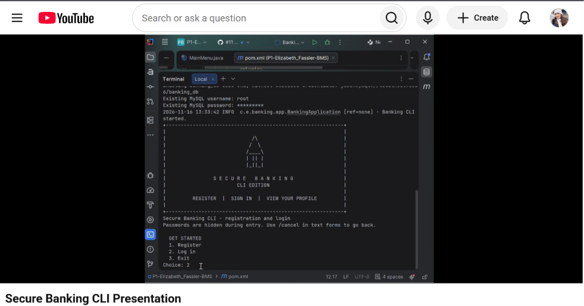

# Secure Banking CLI
A banking application being built with **Java 27, Maven, JDBC, and MySQL 8.4.x**.

The goal is to let customers register, sign in, manage accounts, and carry out banking transactions while learning how to handle validation, security, and database transactions correctly.

## Demo Presentation

## Documentation Navigation
- [Project overview and current status](#current-status)
- [Copy, build and run the final feature batch](#term-deposit-and-loan-handoff)
- [Add synthetic customers safely](#dummy-data-guide)
- [What to show and what remains](#demo-verification-and-remaining-work)
- [Step-by-step implementation plan](#implementation-plan)
- [Design decisions](#design-decisions)
